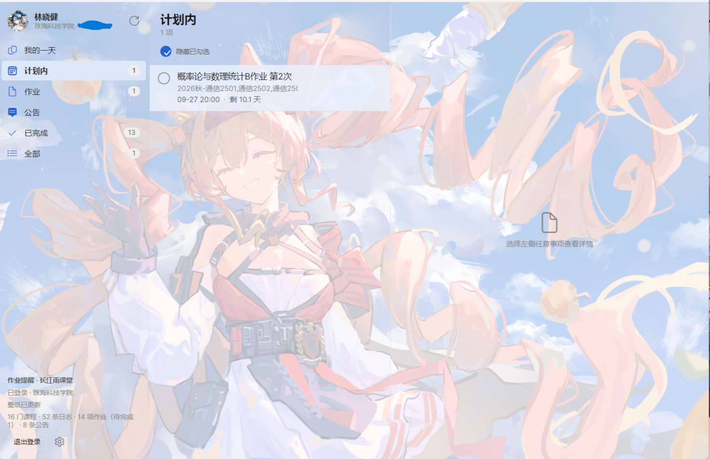
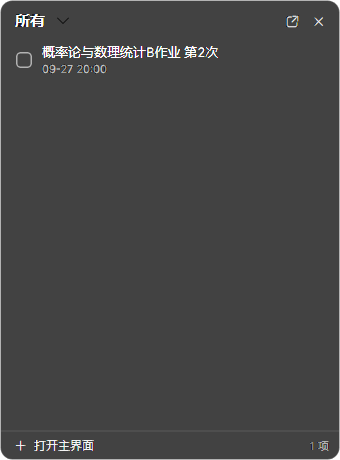

# 作业提醒 · HomeworkReminder

用 Avalonia 写的 Windows 桌面待办应用：自动读取**长江雨课堂**的作业与公告，
以仿 Microsoft To Do 的 Fluent 界面呈现。



## 功能与特性

* **作业清单**：按课程归集作业，显示截止时间与剩余天数，逾期自动标红

* **真实完成状态**：完成进度直接来自雨课堂的作答记录，而不是「截止时间过了没有」

* **公告未读**：公告按已读/未读分组，支持单条已读与全部已读

* **两种登录方式**：应用内嵌官方登录页微信扫码；没有 WebView2 的机器可改用粘贴 Cookie 登录

* **Fluent 半透明界面**：亚克力磨砂背景，支持自定义壁纸与透明度滑块

* **深色模式**：浅色 / 深色 / 跟随系统，即时切换

* **托盘常驻**：关闭时可选择「最小化运行」，收到新作业随时点开

* **隐私安全**：登录态文件用 Windows DPAPI 加密存放，只有本机当前用户能解开

* **学期可配置**：编辑数据目录下的 `settings.json` 即可切换学期与学校，不用改代码

* **定时自动同步**：默认每 30 分钟同步一次作业列表，间隔可在 `settings.json` 调整（`0` = 关闭）

* **新作业通知**：发现新作业时发 Windows 系统通知，点击直达该课程的雨课堂页面

* **桌面小组件**：仿滴答清单的桌面挂件，半透明玻璃面板、可拖动、可缩放，位置与尺寸自动记忆，浅色/深色跟随主程序

## 快速开始

双击运行 `HomeworkReminder.Desktop.exe`，**启动直接进主界面**（登录不再是启动门禁）。
没有登录态时列表顶部会有一条「去登录」引导，点它直达设置页的「账号」选项卡。

在**设置 → 账号**里可以分别登录三个数据源：

1. **雨课堂**——点「扫码登录 / 重新登录」，应用内嵌官方登录页，微信扫码即可；
   缺少 WebView2 运行时时点「使用 Cookie 登录」，从浏览器 F12 → Network
   复制任意 `v2/api/web` 请求的 `cookie` 请求头粘贴进去；
2. **学习通（超星）**——点「登录学习通」，在内嵌登录页用账号密码 / 短信 / 邮箱登录，
   登录成功自动捕获会话；
3. **批改网（句酷）**——点「登录批改网」，在内嵌的批改网页面输入账号密码，
   登录成功自动捕获会话，同步**未完成作文**为待办。

三者可以只登一个，也可以任意组合；待办列表会把各来源的作业合并显示。
登录态失效时不会弹回登录页，而是列表顶部横幅提示，已缓存的列表继续可见。

> 三个数据源都**只保存会话 Cookie**（Windows 下用 DPAPI 加密），
> 不保存账号密码：登录一律在应用内嵌的官方页面里完成。

## 自动同步与通知

默认每 **30 分钟**自动同步一次。**首次同步只建立基线**，不会把已有作业全报一遍；
之后每次同步只对**新增**作业发通知。判定用稳定 Id 而非标题，改标题不会误报。

界面上「剩余 N 天 / 已过期」这类文案由独立的分钟级计时器刷新（不依赖同步成功），
因此即便关掉自动同步或长时间离线，倒计时和逾期标记也会照常走，「我的一天」
跨过午夜会自动重算。

相关设置（`settings.json`，与 `session.json` 同目录，改完重启生效）：

| 字段                      | 默认    | 说明                                              |
| ----------------------- | ----- | ----------------------------------------------- |
| `AutoRefreshMinutes`    | `30`  | 自动同步间隔（分钟）。`0` = 关闭；低于 5 会被夹到 5，避免频繁请求被风控      |
| `NotifyOnNewHomework`   | `true` | 是否发系统通知                                        |
| `WidgetVisible`         | `false` | 是否显示桌面小组件                                      |
| `WidgetX` / `WidgetY`   | —     | 小组件位置，拖动后自动写入                                  |
| `WidgetGroup`           | `myday` | 小组件当前分组（myday / homework / planned / all）      |

### 通知链路自检

通知涉及注册表、开始菜单快捷方式与 WinRT 三层，出问题时不易定位，因此单独留了自检：

```powershell
.\HomeworkReminder.Desktop.exe --toastcheck
```

逐项报告：AUMID 注册 → 开始菜单快捷方式 → toast XML 生成与转义 → WinRT 投递（失败给 HRESULT）。

> **实现说明**：未打包（unpackaged）的 Win32 应用发 toast 需要三个条件，缺一不可：
> ① 注册 `HKCU\Software\Classes\AppUserModelId\<aumid>`；
> ② 在开始菜单放一个带 `System.AppUserModel.ID` 属性的快捷方式
> ——实测**只做 ① 不够**，`CreateToastNotifier` 会返回 `0x80070490`（找不到元素）；
> ③ 走 WinRT `ToastNotificationManager`。
> 三处写入都在 HKCU 与用户自己的开始菜单目录，**不需要管理员权限**。
> 本仓库的离线包源没有任何通知相关 NuGet 包，这一层是手写的 COM 互操作
> （`Services/WinRtToast.cs`），与 `Dpapi` 同一取舍。

## 桌面小组件

从**托盘菜单 → 显示桌面小组件**开启，再点一次关闭。

* 无边框、透明、普通窗口层级（不置顶；从托盘/主界面召唤时会到最前），左键拖动移动位置、拖边缘/角落调整大小（停下即记忆）
* 直接复用主界面已同步的数据，**不额外请求网络**，与主界面始终一致
* 双击条目在浏览器打开；点勾选框在应用内标记
* 只显示「服务端未完成 **且** 应用内未勾掉」的事项（雨课堂、学习通、批改网的作业都在内，
  公告按未读计），与主界面口径一致



## 数据存放

| 位置                                               | 内容                                                                                                         |
| ------------------------------------------------ | ---------------------------------------------------------------------------------------------------------- |
| `%LOCALAPPDATA%\HomeworkReminder\`               | `session.json`（雨课堂登录态，DPAPI 加密）、`chaoxing-session.json`（学习通登录态）、`pigai-session.json`（批改网登录态，同样 DPAPI 加密）、`local-state.json`（本地勾选/已读）、`settings.json`（壁纸/透明度/主题等设置）、`todos.json`（待办缓存，各来源的作业都在里面）、`startup.log`（启动日志） |
| exe 旁边的 `HomeworkReminder.Desktop.exe.WebView2\` | 登录页浏览器内核的缓存（WebView2 默认行为）                                                                                 |

数据目录可用环境变量 `HOMEWORKREMINDER_DATA_DIR` 覆盖。

## 打包发布

```powershell
.\tools\publish.ps1 -Mode trim   -NoPdb   # 裁剪单文件：40.8 MB，双击即用（推荐分发）
.\tools\publish.ps1 -Mode single -NoPdb   # 完整单文件：约 100 MB，兼容性最好
.\tools\publish.ps1 -Mode fdd             # 框架依赖：体积最小，目标机需装 .NET 10 运行时
.\tools\publish.ps1 -Mode sc              # 自包含多文件
```

产物在 `publish\<模式>\` 下。**分发前请删除产物目录里的 `.WebView2` 文件夹**
（里面是本机登录页的 cookie 缓存），只发 exe 文件本身。

### 发布产物自检

```powershell
.\HomeworkReminder.Desktop.exe --selfcheck out.png   # 窗口/绑定自检 + 离屏渲染
.\HomeworkReminder.Desktop.exe --jsoncheck           # 序列化路径自检（裁剪版必过项）
.\HomeworkReminder.Desktop.exe --toastcheck          # 通知链路自检
.\HomeworkReminder.Desktop.exe --selfcheck-widget w.png  # 小组件渲染自检
.\HomeworkReminder.Desktop.exe --cxcheck             # 学习通课程任务点在线自检（只读）
.\HomeworkReminder.Desktop.exe --detailcheck         # 详情面板互斥回归（课程/待办不叠加）
.\HomeworkReminder.Desktop.exe --updatecheck         # 检查更新并走完整更新流程（视为用户已同意）
.\HomeworkReminder.Desktop.exe --updatecheck --target <exe>  # 同上，但替换指定 exe（沙箱演练用）
.\HomeworkReminder.Desktop.exe --pigailogin <账号> <密码>  # 批改网登录捕获链路
.\HomeworkReminder.Desktop.exe --pigaitest "<cookie>"      # 批改网下游链路
```

> **演练应用内更新**：把整套程序文件复制到临时目录，再用副本跑
> `--updatecheck --target <副本exe>`。`--target` 会替换那个副本而不是当前安装目录，
> 因此可以完整验证「下载 → 校验 → 替换 → 重启」而不影响正在用的安装。
> 要让更新真的被触发，被测版本的版本号必须低于远端 tag。

退出码为 0 即表示产物健康。`--cxcheck` / `--pigailogin` / `--pigaitest` 会真实访问
对应站点（只读，不修改远端状态），需要本机已有对应登录态或传入凭据。

> 渲染其他视图：`HWREMINDER_SELFCHECK_NAV=course` 可让 `--selfcheck`
> 渲染「课程」视图而不是默认的「作业」视图。

### 发版流程（含应用内更新所需的清单）

版本号的**唯一事实来源**是仓库根目录的 `Directory.Build.props`
（桌面与 Android 共同继承，桌面 exe 的版本信息也由它决定）：

```powershell
# 1. 改版本号（两处，必须与 tag 一致）
#    - Directory.Build.props        的 <Version>
#    - HomeworkReminder.Android/*.csproj 的 <ApplicationDisplayVersion>
#      （APK 的版本号不走 Directory.Build.props，需单独改，改后要重建 APK）

# 2. 一键发布：校验版本一致性 → 打包 → 生成 update-manifest.json → 上传
$env:GITHUB_TOKEN='<GitHub 令牌>'; $env:GITEA_TOKEN='<Gitea 令牌>'
.\tools\release.ps1 -Tag v1.4.0 -Upload

# 带 Android APK（历史 release 都带）
.\tools\release.ps1 -Tag v1.4.0 -Upload `
  -AndroidApk .\HomeworkReminder.Android\bin\Release\net10.0-android\com.CompanyName.HomeworkReminder-Signed.apk

# 只校验并打包、不上传
.\tools\release.ps1 -Tag v1.4.0

# 产物已生成、只想重传（例如补权限后）
.\tools\release.ps1 -Tag v1.4.0 -SkipBuild -Upload
```

**版本号必须与 tag 一致**，否则客户端会陷入更新循环（装了新版仍报旧版号，每次检查都提示有更新）。
`release.ps1` 会强制校验并在不一致时拒绝出包。

上传需要两个环境变量（**不要写进仓库**）：

| 变量 | 需要的权限 |
|---|---|
| `GITHUB_TOKEN` | 细粒度令牌需 **Contents: Read and write**（仅有读权限时创建 release 会返回 403 `Resource not accessible by personal access token`） |
| `GITEA_TOKEN` | 仓库写权限（访问令牌） |

> 两个源的失败**互不阻断**：任一失败会记录并继续，最后汇总以非零码退出，
> 并打印补传命令。所以可以先只配一个令牌、之后再补另一个。

要在某个 release 上启用「应用内一键更新」，该 release 必须同时包含两个资产：

| 资产 | 作用 |
|---|---|
| `HomeworkReminder-<tag>-win-x64.zip` | 更新包，**内含单个 exe**（trim 模式，约 17 MB） |
| `update-manifest.json` | 更新清单：确切文件名 + SHA256 + 大小（含 android 字段） |

Android APK（`HomeworkReminder-<tag>-android.apk`）也放在同一个 release，
但**不参与更新链路**——客户端自动更新只针对桌面端。

> 打包需要联网还原：自包含发布依赖 runtime pack，而仓库根的 `NuGet.Config`
> 把包源清成只剩本地文件夹源，因此 `publish.ps1` / `release.ps1` 会传 `-OnlineRestore`
> 把 nuget.org 作为**额外源**（不改动 `NuGet.Config` 本身）。

> 没有清单时仍可更新（按资产名兜底挑包），但**无法校验哈希**，会退化为只做版本兜底检查；
> 建议每个 release 都带上清单。

### 登录页排查开关（环境变量）

登录页是雨课堂自己的网页，出问题时只能看运行时的真实 DOM。以下开关只读页面、
不改行为，产物落盘在数据目录：

| 环境变量                        | 产物                | 作用                                                        |
| --------------------------- | ----------------- | --------------------------------------------------------- |
| `HWREMINDER_LOGIN_DOM_DUMP=1` | `login-dom.txt`   | 主文档的关键元素与坐标（原有）                                        |
| `HWREMINDER_LOGIN_PROBE=1`    | `login-probe.txt` | **主文档 + 各 iframe 的可见文本、按钮/链接、二维码元素**（登录方式实际在 iframe 里，只 dump 主文档看不到） |
| `HWREMINDER_PIGAI_DEBUG=1`    | `pigai-login.log` | 批改网登录探测：每次导航、Cookie 名字与域、捕获判定。只记 Cookie **名字**，不记值          |
| `HWREMINDER_CLEAR_WEBVIEW_LOGIN=1` | —            | 进入登录页前先清掉 WebView 里的持久化登录态，便于看到二维码而不是直接接管旧会话              |
| `HWREMINDER_FORCE_LOGIN=1`    | —                 | 正常运行模式下也强制停在登录覆盖层，便于在真窗口里复现问题                             |

### 批改网登录链路的自检
批改网登录**严格沿用雨课堂那条已跑通的路径**：打开覆盖层后起一个 async 轮询循环
（`Task.Delay` + `ConfigureAwait(true)` 回到 UI 线程），循环里先用页面内脚本探测
「登录是否真的生效」，确认后再读 Cookie 建会话。

- 探测脚本必须**同步返回**（WebView2 不等待 Promise，会把等待中的 Promise 序列化成 `{}`）；
- 判定看**响应正文**而不是状态码：批改网未登录时受限页面也返回 200，
  只是渲染「请先登录」；
- 每次探测外包 3 秒超时，避免页面跳转中途把循环拖住。

为什么不只等导航事件：用户输完账号密码要十几秒到几十秒，这期间不会再有导航事件；
登录提交是表单 POST，是否触发一次导航完成事件并不保证。

两个自检模式可分别验证上下游：

```powershell
# 上游：驱动登录页填表提交，验证「登录后能自动捕获并返回」
.\HomeworkReminder.Desktop.exe --pigailogin <账号> <密码> 150

# 下游：给一条真实会话 cookie，验证「接管 → 关覆盖层 → 同步 → 待办出现作文」
.\HomeworkReminder.Desktop.exe --pigaitest "<整条cookie>" 120
```

两者退出码 0 即通过。凭据/cookie 只从命令行读进内存，不落盘、不写日志。
（注意：`--pigailogin` 用脚本 `form.submit()` 提交，会绕过批改网自己的
密码加密 JS，因此**该模式可能被站点拒绝**——它验证的是探测与捕获机制，
不是站点能否登录；真实用户在页面里手动输入走的是站点自己的 JS。）

> 排查「微信快捷登录」时的已知事实：该入口渲染在 `/authorize/wx-qrlogin` 的 iframe 内，
> 且页面**不做自动探测**（`login.js` 里的探测标志 `Pt` 恒为 `false`，只有点击按钮才置位），
> 因此页面始终显示「微信快捷登录 / 扫码登录」二选一，而不是自动判断本机有没有微信。

## 项目结构

```
HomeworkReminder/                 共享项目：模型、服务、视图、ViewModel
  Models/                         TodoItem 等数据模型
  Services/                       每个数据源一套「客户端 + 登录 + 会话 + 同步」：
    YktApiClient / YktLoginService / SessionStore / SyncService
                                  雨课堂：课程日志 + 完成进度（唯一按课程扇出的来源）
    ChaoxingApiClient / ChaoxingLoginService / ChaoxingSessionStore / ChaoxingSyncService
                                  学习通：作业与考试两个列表 + 课程未完成任务点（均 HTML 解析）
    PigaiApiClient / PigaiLoginService / PigaiSessionStore / PigaiSyncService
                                  批改网：未完成作文列表（HTML 解析）
    AppJsonContext.cs             源生成 JSON 序列化上下文
    AutoSyncService.cs            定时同步 + 新作业判定（可脱离 UI 测试）
    Notifier.cs / WinRtToast.cs   系统通知抽象与 WinRT COM 互操作
    ---- 课表（教务系统导入）----
    Timetable.cs                  课表纯逻辑：节次时间表、单双周、周次换算、按周展开
    ZhengfangParser.cs            正方教务课表解析内核（kbList JSON / 列表视图 / 网格兜底）
    ZhengfangHtml.cs              课表页的轻量 HTML 抽取（去标签、实体、表格、课块）
    ScheduleStore.cs              schedule.json 读写与逐条校验
    ScheduleMerge.cs              合并导入（匹配键去重、事务式、不删既有）
    JwCaptureService.cs           教务页悬浮球注入与一键抓取
  Views/                          MainWindow / TodoShellView / LoginView
                                  ChaoxingLoginView / PigaiLoginView
                                  TimetableView（周视图网格）/ JwImportView（教务导入）
                                  WidgetView + WidgetWindow（桌面小组件）
  Styles/TodoTheme.axaml          仿 To Do 的 Fluent 控件样式（含深色主题）
  Styles/WidgetTheme.axaml        桌面小组件的深色半透明样式
HomeworkReminder.Desktop/         桌面宿主（启动、托盘、自检入口）
HomeworkReminder.Android/         Android 宿主（抽屉式外壳、原生 CookieManager 钩子）
tools/                            构建、发布、冒烟测试脚本
docs/                             接口实测文档与调研记录
  ykt-api.md                      雨课堂接口实测
  三源作业获取实现规格.md           ★ 三个源的获取实现规格（端点/参数/解析/坑），可直接照此移植
  界面设计规格.md                   ★ 界面设计规格（色板/令牌/控件/布局/响应式），可照此复刻
  数据源获取逻辑.md                本项目的整体架构与同步流程
  学习通状态探测.md                学习通任务点/作业/考试状态的探测定论
  教务课表导入.md                  ★ 正方课表解析口径、与 Electron 参照实现的差异、安全边界
```

## 开发

```powershell
.\tools\run.ps1                              # 构建并启动（数据目录指向 .appdata）
dotnet run --project tools\SyncSmoke         # 无界面跑一遍真实同步，打印待办结果
```

> 本仓库默认离线还原配置（`NuGet.Config` 指向仓库内 `packages/`）。在可联网的
> 机器上可删除 `NuGet.Config`、`packages/`、`.nuget-packages/`，直接 `dotnet restore`。

## 已知限制

* 雨课堂没有「学生标记作业完成」的接口，应用内的勾选只影响本地视图

* 全部接口来自雨课堂网页端自身，非公开契约，前端改版可能导致失效；
  代码对每个调用做了容错（单课程失败不中断整次同步，并汇总为界面警告条）

* Android 端已验证可用（登录/同步/待办列表；登录页自动切换为账号密码/短信/邮箱登录，
  因为手机扫不了自己屏幕上的二维码）；iOS / Browser 端沿用模板但未经验证

